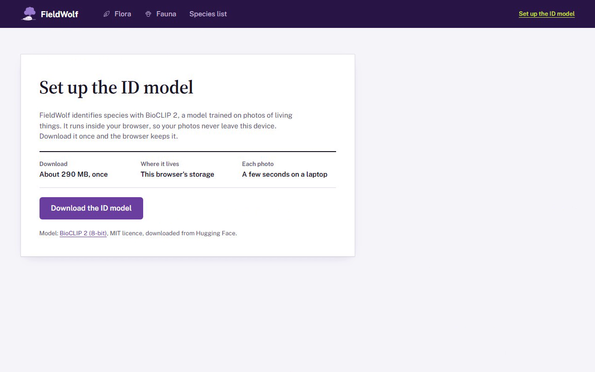
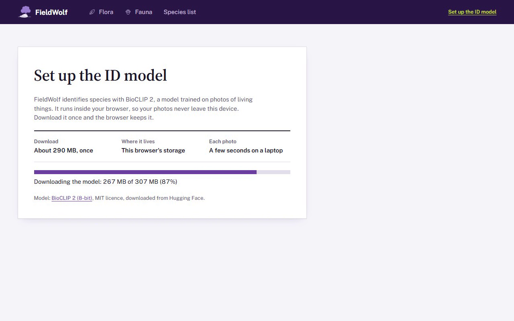
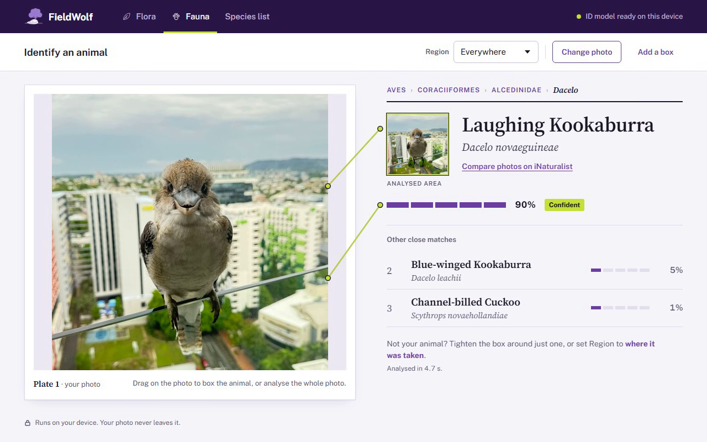
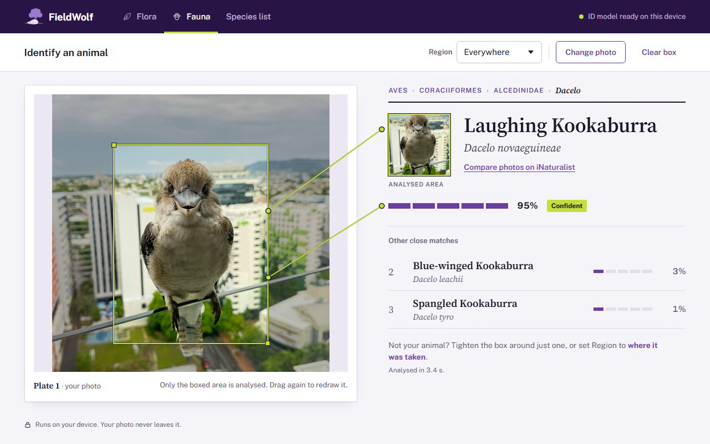
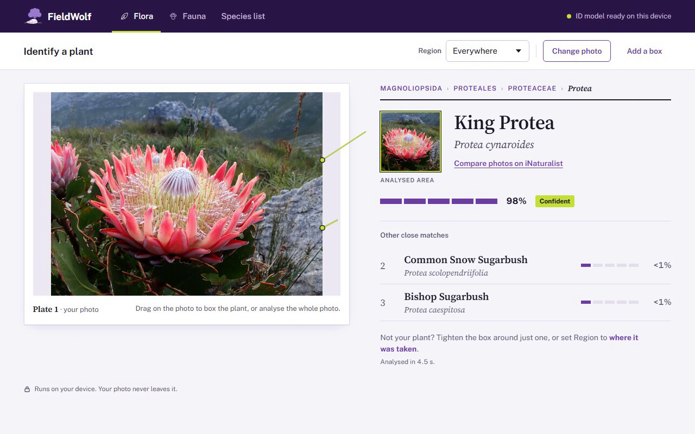
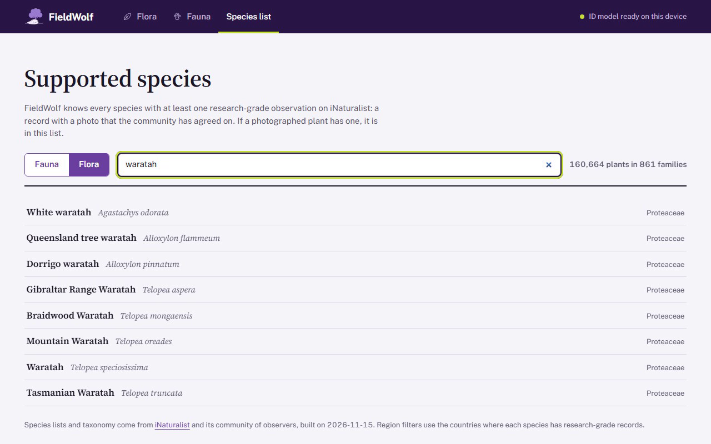

# FieldWolf demo

A first-time visitor sets FieldWolf up, identifies an animal and a plant, and searches the species list. Nothing is staged. The recording is a real Playwright run (`npx playwright test --project=demo`, see `e2e/demo.spec.ts`) against the production build, using the real model and the full species tables. It doubles as an end-to-end test.

The full-quality recording is [docs/demo/fieldwolf-demo.mp4](docs/demo/fieldwolf-demo.mp4) (70 seconds).

## Step by step

### 1. First visit: the model is not set up yet

Home offers the two guides, Flora and Fauna. A warning explains that the ID model has to be downloaded once, and links to setup. Opening a guide before setup shows the same warning as a popup.

### 2. Setup: one download, kept by the browser

`/setup` downloads BioCLIP 2 (about 290 MB) from Hugging Face, with real progress, and keeps it in the browser's Cache API. When it finishes, the visitor lands back on home with "Your setup is done". In a private window, where browsers often refuse to store a file this large, the model is kept in memory for that tab, and the message says so.

### 3. Identify an animal

On `/fauna`, the visitor adds a photo. FieldWolf compares it with all 5,062 animal families, fetches the 20 most likely families' species, and names the best match. The proof crop sits beside the name, and the five-step bar shows the confidence. The chartreuse leader lines run from the photo to the answer, like the pointers on a field guide plate.

### 4. Box it, and narrow the region

Dragging on the photo draws a box. Only the boxed area is analysed, and the lines now start from the box. Setting Region to Oceania, then Australia, limits the answer to species recorded there.

### 5. Identify a plant

The same flow on `/flora`, against 160,664 plant species in 861 families.

### 6. Every supported species

`/species` lists every species FieldWolf knows, grouped by class and family, with a search over common and scientific names.

## How accurate is it?

The test set is 20 photos, 10 animals and 10 plants, from every continent: CC0 and CC BY iNaturalist observations, credited in `e2e/fixtures/photos/photos.json`.

| Check | Result |
|---|---|
| Named first, region "Everywhere" | **18 of 20** |
| Among the three names shown, "Everywhere" and by continent | **20 of 20** |

The two that are not named first, shown as the app answers them:

- **Indian Peafowl.** The photo is a head-only close-up on white. FieldWolf says "Not sure" and lists *Pavo cristatus* third.
- **Pōhutukawa.** FieldWolf says "A kind of *Metrosideros*", with its close relative *M. nervulosa* first and *M. excelsa* second.

Both are honest near-misses rather than confident wrong answers. Run them yourself:

- `npm run accuracy` in `tools/` runs the check offline, with the same ranking code the browser runs.
- `npx playwright test` runs it through the real app.
