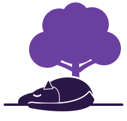

<p align="center"></p>

# FieldWolf

FieldWolf names the plant or animal in a photo, entirely in your browser. Pick **Flora** or **Fauna**, add a photo, box the living thing, and read its name. Your photo never leaves your device.

**Live:** https://australianraven.github.io/field-wolf/ · **Demo:** [DEMO.md](DEMO.md)

## What it knows

Every species with at least one research-grade observation on [iNaturalist](https://www.inaturalist.org): 301,516 animals and 160,664 plants (hybrids left out). A research-grade observation is a dated, located photo that the community agrees on, so nearly anything someone has photographed is in the list. The app's **Species list** page lets you search all of them.

## How it works

1. **The model.** [BioCLIP 2](https://huggingface.co/imageomics/bioclip-2), a CLIP-style model trained on photos of living things, 8-bit quantised ([mahan-ym/bioclip-2-quantized](https://huggingface.co/mahan-ym/bioclip-2-quantized), MIT, about 290 MB). `/setup` downloads it once into the browser's Cache API.
2. **The photo.** The boxed area (or the whole photo) is resized to 224 × 224 and turned into a 768-number fingerprint by ONNX Runtime Web, in a Web Worker, on one CPU thread. That takes a few seconds on a laptop.
3. **Family first.** The fingerprint is compared with one fingerprint per family (5,062 animal families and 861 plant families). Each family's fingerprint is the average of its species' fingerprints.
4. **Then species.** Only the 20 best families' species are fetched (one small file each, cached) and ranked. When a region is set, species not recorded in that continent or country are removed before ranking.
5. **Honest answers.** A species is "Confident" only when the photo really looks like the name (cosine ≥ 0.72) and it takes at least 80% of the probability. Otherwise the answer falls back to the genus or family that holds most of it, or says "Not sure".

Species fingerprints come from BioCLIP 2's text encoder, run offline over each species' taxonomy and common name, for example `a photo of Animalia Chordata Aves Coraciiformes Alcedinidae Dacelo novaeguineae with common name Laughing Kookaburra.`

## Develop

```sh
npm install
npm run dev          # http://127.0.0.1:5180/field-wolf/
npm run check        # lint, typecheck, unit tests, build (what CI runs)
npx playwright test  # end-to-end, local only (see below)
```

### End-to-end tests (local only)

Playwright runs the production build with the real model. It identifies 10 animals and 10 plants from every continent (`e2e/identify.spec.ts`; 18 named first, all 20 among the names shown, see [DEMO.md](DEMO.md#how-accurate-is-it)), and exercises setup, the box, the region filter and the species list. Run `cd tools && npm install && npm run fetch-models` first, so the tests serve the model from disk instead of downloading it per test. These tests are deliberately not in GitHub Actions: they need the 290 MB model and take minutes.

`npx playwright test --project=demo` records the walkthrough video used in [DEMO.md](DEMO.md).

## Rebuild the species data

The tables in `public/data/` are generated by the scripts in `tools/`, a separate npm package that CI never installs:

```sh
cd tools
npm install
npm run fetch-models      # BioCLIP 2 image and text encoders (~770 MB, git-ignored)
npm run fetch-species     # every research-grade species, per kingdom (iNaturalist API, ~20 min)
npm run fetch-taxonomy    # the iNaturalist taxonomy export, for class, order and family
node build-list.mjs       # join them
npm run fetch-regions     # species per country (iNaturalist API, ~2 h)
node embed.mjs fauna      # text fingerprints (hours; FW_DML=1 adds a DirectML GPU worker on Windows)
node embed.mjs flora
node pack.mjs fauna tax mean
node pack.mjs flora tax mean
npm run fetch-photos      # the 20 test photos
npm run accuracy          # identify them offline with the same code the browser runs
```

Each rebuild changes `meta.json`'s version, so browsers fetch the new tables instead of mixing old and new. The tables are a few hundred MB, so rebuild them only when the species lists are worth refreshing.

## Credits

- Species lists and taxonomy: [iNaturalist](https://www.inaturalist.org) and its observers.
- Model: BioCLIP 2 by the Imageomics Institute; 8-bit ONNX export by mahan-ym (MIT).
- Test photos: iNaturalist observers, CC0 or CC BY. Each one is credited in `e2e/fixtures/photos/photos.json`.

## Licence

MIT. See [LICENSE](LICENSE).
